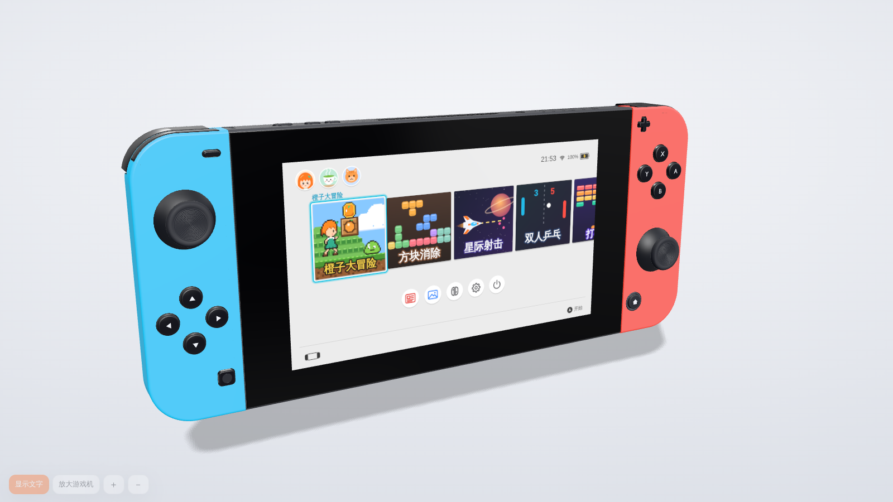
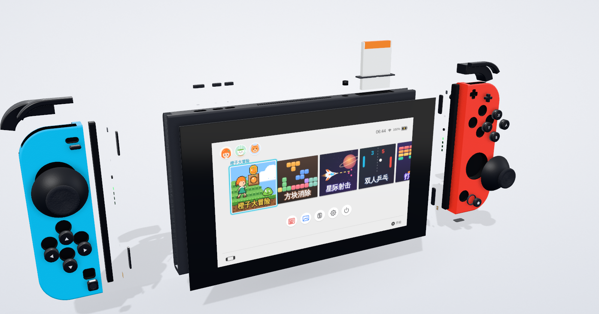

# Switch 3D 交互模型

用 **Blender 程序化建模**的 Switch 风格掌机，在浏览器里可以 360° 旋转、拉近到毫米级查看每一个细节，
并且**直接按上面的按键玩屏幕里的游戏**（键盘、鼠标点按 3D 按键、触屏、USB/蓝牙手柄都可以）。





> 非官方粉丝作品，与任天堂（Nintendo）无关。“Nintendo Switch”是任天堂的商标。
> 本项目没有使用任何任天堂的素材：模型由脚本按公开尺寸生成，系统界面、图标、游戏、角色、音效全部为原创程序绘制 / 合成。

## 快速开始

- **直接打开**：双击 [`dist/index.html`](dist/index.html)（单文件，内嵌 three.js 和模型，可离线使用）。
- **本地开发**：
  ```bash
  npm install
  npm run dev      # 构建 + 监听改动，预览 http://localhost:5173
  npm run build    # 只构建 dist/index.html
  ```

## 能做什么

| 功能 | 说明 |
| --- | --- |
| 游玩模式 | 左下角“游玩模式”或按 `G`：镜头锁定、主机（插底座时是电视）铺满窗口，鼠标拖动 / 滚轮 / 双击都不会再转动主机；只有按键、摇杆和触摸屏能点，拆手柄、开支架、插底座这些操作暂时停用，网页快捷键也不响应，按 `Esc` 退出并回到原来的视角 |
| 查看细节 | 左键拖动旋转、滚轮**朝鼠标指针方向**缩放、右键平移、**双击任意部件拉近**；10 个预设视角（游玩、正面、背面、顶部、底部、侧面、左右手柄、摇杆特写） |
| 按键 | 每颗按键都是独立部件：键盘按下时 3D 按键同步下沉并发光，鼠标点击 3D 按键 = 按下它，拖动摇杆 = 推摇杆 |
| 触摸屏 | 直接点击 3D 屏幕上的磁贴 / 按钮（和真机触摸屏一样） |
| 拆装 Joy-Con | 沿滑轨滑出 / 装回，露出 SL / SR、玩家指示灯、同步键、触点和主机侧面的金属滑槽 |
| 支架 / 卡槽盖 | 背面支架可打开（下面是 microSD 卡槽），顶部游戏卡槽盖可掀开 |
| 爆炸视图 | 玻璃面板、每颗按键、摇杆、扳机、滑轨零件、支架、游戏卡等沿各自方向分开，方便看清结构 |
| 底座 / TV 模式 | 主机插入底座后掌机屏幕熄灭、底座指示灯亮起，画面切到后面的电视上 |
| 开机动画 | 打开网页时主机是关着的：点“开机”（或按任意键）后两只 Joy-Con 依次滑进滑轨、指示灯闪烁，镜头移到顶部按下电源键，屏幕亮起播放原创的开机画面，HOME 磁贴依次入场；`Esc` 跳过，面板里可以“重播开机动画” |
| 画质 | 后期环境光遮蔽（按键孔、滑轨缝里的柔和阴影）、摄影棚环境反射、塑料磨砂 / 摇杆橡胶 / 金属拉丝的细微表面纹理、地面接触阴影；拉近看屏幕时系统画面自动切到 2560×1440。画质分 自动 / 高 / 中 / 低 四档，“自动”会按帧率降档 |
| 隐藏文字 / 放大游戏机 | 左下角工具条（快捷键 `T` / `F`）：一键隐藏标题、面板、提示等周围文字；一键把整台主机放大铺满窗口，`＋` `－` 逐级缩放 |
| 其他 | 键位标注（在每颗 3D 按键旁显示对应键盘键）、自动旋转、线框模式、明暗主题、全屏、3D 截图、手机触屏手柄、可收起的控制面板 |

## 键盘操作

| Switch 按键 | 键盘 |
| --- | --- |
| 左摇杆 | `W` `A` `S` `D`（按下：左 `Shift`） |
| 十字键 | `↑` `↓` `←` `→` |
| A / B / X / Y | `L` / `K` / `I` / `J`（菱形排列，和手柄上的位置对应；A 也可以用 `空格`、`回车`，B 也可以用 `退格`） |
| 右摇杆 | 小键盘 `8` `4` `5` `6`（按下：右 `Shift` / 小键盘 `0`），或用鼠标拖动 3D 摇杆 |
| L / ZL · R / ZR | `Q` / `E` · `O` / `U` |
| + / − | `=` / `-` |
| HOME · 截图键 | `H` · `C` |
| SL / SR | 左手柄 `Z` / `X`，右手柄 `N` / `M` |
| 电源键 · 音量 | `P`（长按 2 秒打开电源菜单） · `]` / `[` |

按 `?` 可以随时在网页里打开完整的对照表；`G` 进入 / 退出游玩模式（`Esc` 也能退出），`T` 隐藏 / 显示周围文字，`F` 放大游戏机（再按一次恢复）。

网址参数：`?q=high|medium|low|auto` 指定画质，`?intro=0` 跳过开机动画（系统设置了“减少动态效果”时也会自动跳过镜头动画）。

## 内置系统与游戏

屏幕里运行的是原创的“茶室 OS”：开机动画（八瓣橙子拼成切面、果皮描边、光泽扫过、文字逐字落下，约 4 秒，1.4 秒后可按 A / B 跳过）、仿真机布局的 HOME 菜单（磁贴 + 圆形系统按钮）、锁屏（连按三次同一按键解锁）、
睡眠 / 电源菜单、音量浮层、截图相册、系统设置（亮度、主题、音量、按键说明）。

内置的经典玩法小游戏（美术、关卡、音乐全部原创）：

| 游戏 | 玩法 / 操作 |
| --- | --- |
| 橙子大冒险 | 8-bit 横版闯关：按住 B 奔跑、A 跳（按得越久跳得越高）、顶砖块和道具箱、大橙子变大、茶杯后按 B/Y 扔茶叶球、踩怪踢壳、站在茶罐上按 ↓ 进隐藏房间，终点抓旗杆进茶室；4 关（茶园小径、地下茶窖、天空、城堡 Boss） |
| 方块消除 | 七种四格方块：A/X 顺时针、B/Y 逆时针旋转，↓ 软降，↑ 或 ZR 硬降，L/R/ZL 暂存，逐级加速 |
| 星际射击 | 按住 A 连发，B 炸弹，波次敌人 + 三阶段 Boss |
| 双人乒乓 | 左 Joy-Con 控左拍、右 Joy-Con（右摇杆 / X、B）控右拍，没人操作时右拍由电脑接管，先到 7 分赢 |
| 打砖块 | 摇杆移动挡板，A 发球 / 发射激光，多种道具与关卡 |
| 扫雷 | 9×9 / 16×16，A 翻开，B/Y 插旗，首次点击必安全，可以直接点屏幕 |
| 贪吃蛇、2048 | 经典玩法；2048 里 Y 撤销一步 |
| 手柄测试 | 实时显示所有按键和摇杆数值（HOME 下方的“手柄”按钮） |

所有游戏都有标题页、计分、最高分（存在浏览器本地）和暂停菜单（`+` 键）。

## 模型

`blender/build_switch.py` 用 bmesh 从零生成全部几何体（约 10 万个三角面：外壳、按键、摇杆都按细分曲面生成，按键孔、摇杆孔、接口孔口都带圆角，散热孔是在机身上直接开的槽），
并给每个部件生成盒投影 UV（1 个 UV 单位 = 10 mm），网页端据此贴上程序生成的表面纹理。输出 `web/assets/switch.glb` 和 `blender/switch.blend`：

```bash
blender -b -P blender/build_switch.py          # 已安装 Blender
# 或者
pip install bpy && python blender/build_switch.py
python blender/build_switch.py --render out/   # 额外用 Cycles 渲染 7 张预览图
```

- 尺寸依据任天堂公布的初代机（HAC-001）规格：装上 Joy-Con 后 **102 × 239 × 13.9 mm**，摇杆顶端到 ZL/ZR 顶面 **28.4 mm**，
  **6.2 英寸 1280×720** 屏幕（[任天堂官方规格页](https://www.nintendo.com/sg/hardware/switch/modal/specs/body.html)）。
- 主机平板 173 mm 宽、每只 Joy-Con 外露 33 mm；按键、接口、散热孔、支架等部件的具体位置和大小是对照外观估算的，不是官方图纸。
- 每个可交互部件都是 GLB 里的独立节点，带 extras 描述（按压方向、扳机转轴、摇杆转动中心、开合角度、提示文字），
  网页端据此驱动动画；在 Blender 里打开 `.blend` 按 F12 就能用自带的相机和灯光渲染。

## 渲染

- three.js：多重采样的半精度浮点缓冲 → GTAO 环境光遮蔽（画面和物体都没动时沿用上一帧的结果）→ 输出；阴影贴图也只在物体移动时重画。
- 环境光是程序生成的“摄影棚”：渐变背景 + 几块柔光箱 / 灯条，按键和玻璃上会出现干净的条形高光。
- 表面纹理（磨砂颗粒、橡胶颗粒、金属拉丝、光泽变化）在浏览器里用可平铺噪声实时生成，不需要额外的图片文件。
- 构建时 GLB 先 gzip 再内嵌（约 3 MB → 1.3 MB），网页里用 three.js 自带的 fflate 解压。

## 目录结构

```
blender/build_switch.py   Blender 程序化建模脚本
blender/switch.blend      生成的 Blender 工程
web/assets/switch.glb     导出的模型
web/index.html            页面与样式
web/src/main.js           入口：加载模型、交互、主循环
web/src/scene.js          渲染器、相机、灯光、阴影、后期、画质分档
web/src/look.js           表面纹理、材质参数、摄影棚环境、背景
web/src/device.js         按键 / 摇杆 / 拆装 / 底座等动画
web/src/input.js          键盘、鼠标、手柄 → 虚拟 Switch 手柄
web/src/touchpad.js       手机触屏手柄
web/src/os/               屏幕里的系统与游戏（Canvas 2D，1280×720 逻辑坐标，可按 2 倍分辨率绘制）
web/os-test.html          单独调试系统和游戏的测试页
scripts/build.mjs         打包成单文件 dist/index.html
```
